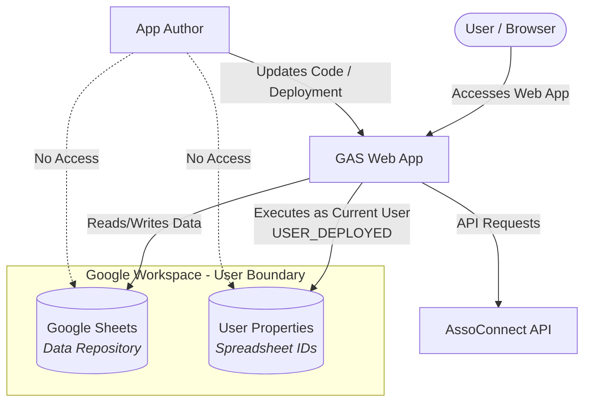

# Gas Maestro

## Overview
Gas Maestro is a Google Apps Script (GAS) web application serving as a centralized control center for extracting, managing, and exploiting data from external sources, starting with AssoConnect.

## Architecture & Design
- **Execution Context**: Runs as the current user (`USER_DEPLOYED`), leveraging Google Workspace permissions to ensure access security and privacy. The application author cannot access user data without explicit permission.
- **Data Repository**: Google Sheets.
- **Configuration**: Spreadsheet IDs are stored in User Properties.
- **Multi-Repository Support**: Users can configure and manage multiple data repositories, while single-repository usage remains the default for the vast majority of users.

## Architecture Diagram

## Development Notes
- **AI Assistance**: Development is assisted and/or augmented using Gemini.
- **Languages**: All development resources (code, comments, and technical documentation) are maintained in English, whereas the user interface (UI) is localized in French.
