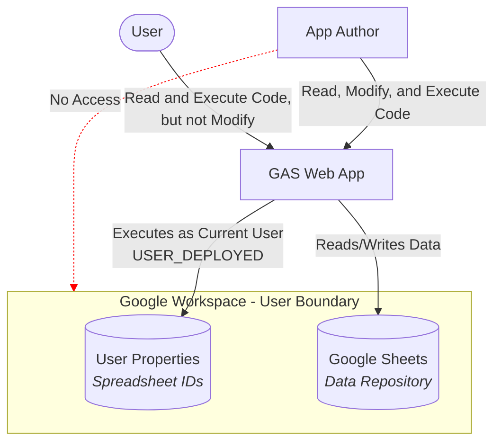

# Maestro

## Overview
Maestro is a Google Apps Script (GAS) web application serving as a centralized control center for extracting, managing, and exploiting data from external sources, starting with AssoConnect.

## Architecture & Design
- **Execution Context**: Runs as the current user (`USER_DEPLOYED`), leveraging Google Workspace permissions to ensure access security and privacy. The application author cannot access user data without explicit permission.
- **Data Storage ("DB")**: Google Sheets is used as the storage backend. Storage files are referred to as **"DB"** (Database) rather than "Repository" to avoid confusion with Git repositories and signal that data storage is backend-agnostic.
- **No Google Sheet Formulae**: The application strictly avoids relying on Google Sheet formulae to prevent needlessly introducing another programming language (formulas). All computations and processing are performed in application code (`Maestro`).
- **Configuration**: Spreadsheet IDs are stored in User Properties.
- **Multi-DB Support**: Users can configure and manage multiple data DBs, while single-DB usage remains the default for the vast majority of users.
- **Namespacing & Global Scope**: To prevent name collisions and global namespace pollution, Google Apps Script evaluates `.gs` files alphabetically. The alphabetically first file (`_Maestro.gs`) declares the single global symbol `const Maestro = {};`. All application logic, classes, and helper functions are attached as properties of `Maestro`.

## Architecture Diagram

## Development Notes
- **AI Assistance**: Development is assisted and/or augmented using Gemini.
- **Languages**: All development resources (code, comments, and technical documentation) are maintained in English, whereas the user interface (UI) is localized in French.
