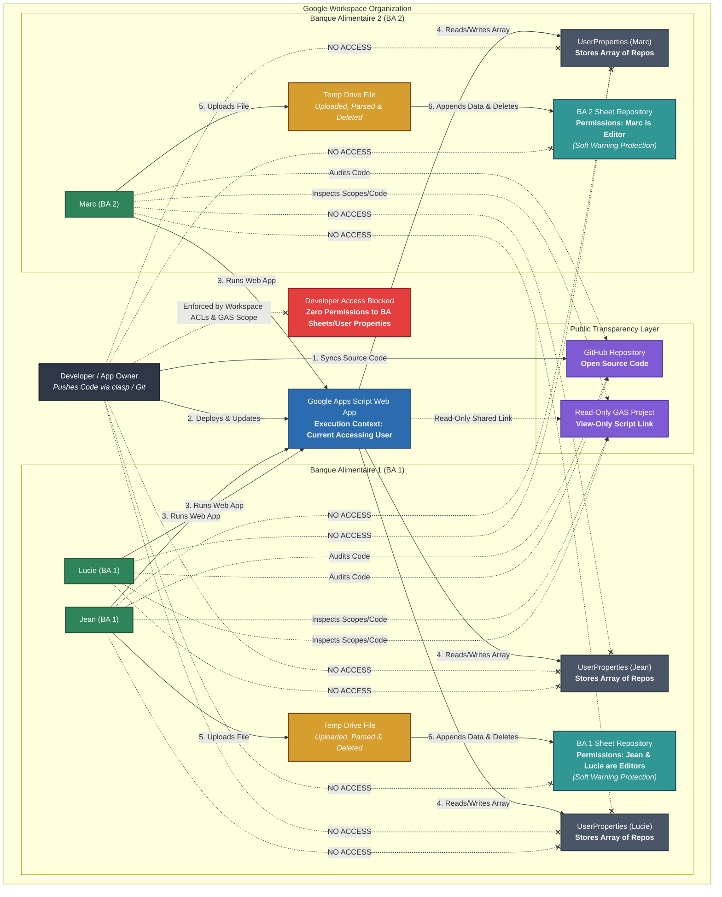

# System Architecture & Technical Specifications

This document outlines the system design, security model, and implementation guidelines for the **Banque Alimentaire (BA) Data Repository Web Application**.

---

## 1. System Overview

The application is an open-source, lightweight Google Apps Script (GAS) Web App designed to aggregate and structure data across various local branches (Banques Alimentaires / BAs). 

Each local branch operates independently, managing its own regional dataset generated from disparate software sources. The application acts as an interface to process, validate, and append data directly to Google Sheets repositories without relying on a central database management system (DBMS).

---

## 2. Design Requirements

### Security & Privacy
* **Zero-Knowledge Developer Model:** The developer/app owner must **never** automatically receive read or write access to any branch's data repository outside of their own.
* **Workspace-Level Authorization:** Access control, identity verification, and permissions are handled natively via Google Workspace domain policies and Google Drive access control lists (ACLs).
* **Strict Execution Context:** The Web App must deploy under `Execute as: User accessing the web app`.
* **Isolated User Storage:** User configurations (e.g., target Sheet references) must strictly use `PropertiesService.getUserProperties()`, guaranteeing isolation across accounts.

### Data Management & Hygiene
* **Data Ingestion via File Upload:** Users can upload local data files (e.g., CSV/TSV) through the Web App.
* **Immediate Cleanup:** Any uploaded file saved temporarily to Google Drive must be processed, ingested, and immediately deleted (`Drive.Files.remove(file.getId())`) to maintain file hygiene.
* **Soft Data Protections:** Repositories retain `Editor` permissions for branch users to allow inspection while using **Warning-Only Protections** (`protection.setWarningOnly(true)`) to minimize manual UI edit accidents without breaking Web App API executions.
* **Multi-Repository Mapping:** The system must natively support users who belong to or manage multiple BAs.

### Open Source & Transparency
* **Public Code Base:** Source code will be version-controlled via GitHub (`clasp`).
* **Auditability:** The production Apps Script project will be shared in **Read-Only** mode, allowing organizational users to audit requested scopes (`appsscript.json`) and source code execution.

---

## 3. Core Technical Architecture

### 3.1 Components

| Component | Technology | Description |
| :--- | :--- | :--- |
| **Frontend UI** | HTML / CSS / JS | Client-side interface served via `HtmlService`. |
| **Backend API** | Google Apps Script (`.gs`) | Processing layer executing in the context of the logged-in user. |
| **Local Repositories** | Google Sheets | Tabular storage engines owned and managed by individual BAs. |
| **State Storage** | `UserProperties` | Serialized JSON storage containing mapping configurations per user. |
| **Version Control** | GitHub & Google `clasp` | Local development workflow sync and public source transparency. |

---

### 3.2 System Architecture Diagram



---

## 4. Implementation Details

### 4.1 Multi-BA Configuration Schema (`UserProperties`)

Repositories are saved per user as a JSON array string under the property key `BA_REPOSITORIES`.

```json
[
  {
    "baId": "BA_13",
    "baName": "Banque Alimentaire 13",
    "spreadsheetId": "1aB2c3D4e5F6g7H8i9J0_example_id_1"
  },
  {
    "baId": "BA_83",
    "baName": "Banque Alimentaire 83",
    "spreadsheetId": "9zY8x7W6v5U4t3S2r1Q0_example_id_2"
  }
]
```

### 4.2 Property Storage Handler (`RepositoryManager.gs`)

```javascript
function getUserRepositories() {
  const props = PropertiesService.getUserProperties();
  const rawData = props.getProperty('BA_REPOSITORIES');
  return rawData ? JSON.parse(rawData) : [];
}

function saveRepository(baId, baName, spreadsheetId) {
  const repos = getUserRepositories();
  const index = repos.findIndex(r => r.baId === baId);
  
  if (index > -1) {
    repos[index] = { baId, baName, spreadsheetId };
  } else {
    repos.push({ baId, baName, spreadsheetId });
  }
  
  PropertiesService.getUserProperties().setProperty('BA_REPOSITORIES', JSON.stringify(repos));
}
```

### 4.3 Data Ingestion & Hygiene Flow (`DataProcessor.gs`)

```javascript
function processUploadedFile(fileBlob, targetSpreadsheetId) {
  // 1. Store temporary file in executing user's Drive
  const tempFile = DriveApp.createFile(fileBlob);
  
  try {
    // 2. Extract and parse data
    const content = tempFile.getBlob().getDataAsString();
    const parsedData = Utilities.parseCsv(content);
    
    // 3. Append to repository using executing user's OAuth scope
    const ss = SpreadsheetApp.openById(targetSpreadsheetId);
    const sheet = ss.getSheetByName('DataRepository') || ss.getSheets()[0];
    
    sheet.getRange(sheet.getLastRow() + 1, 1, parsedData.length, parsedData[0].length)
         .setValues(parsedData);
         
    return { success: true, count: parsedData.length };
  } finally {
    // 4. Guarantee permanent file cleanup (deletion instead of trashing)
    Drive.Files.remove(tempFile.getId());
  }
}
```

### 4.4 Repository Soft Protection (`SheetSetup.gs`)

```javascript
function applySoftProtections(spreadsheetId) {
  const ss = SpreadsheetApp.openById(spreadsheetId);
  const sheets = ss.getSheets();
  
  sheets.forEach(sheet => {
    const protection = sheet.protect().setDescription('Prevent Accidental Direct Edits');
    protection.setWarningOnly(true);
  });
}
```